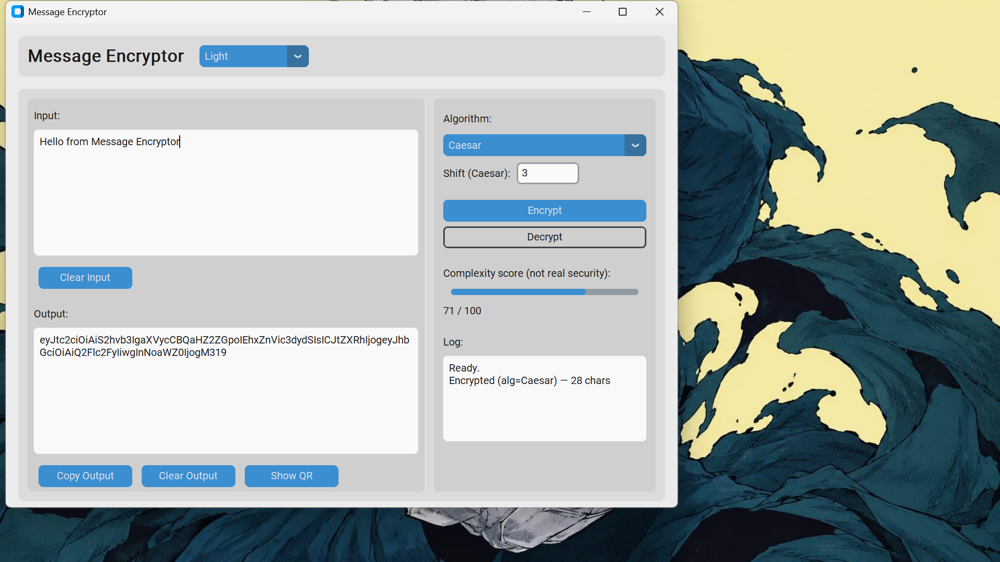

# Message Encryptor


A small desktop app (Python + CustomTkinter) for encoding and decoding messages with classic algorithms, with QR code export.

> **Educational project, not real security.** Caesar, Reverse and Base64 are encodings, not encryption. The output stores the algorithm and Caesar shift next to the message, so anyone can decode it. Don't use this for secrets.



## Features

- Three algorithms: Caesar (adjustable shift), Reverse and Base64
- Output is a self-describing package, so pasting it back into the input and clicking Decrypt just works
- Complexity score for the message (a simple heuristic, not a measure of security)
- Show the output as a QR code and save it as a PNG
- Copy and clear buttons, an activity log, and light, dark and system themes
- Resizable window

## Run it

Requires Python 3 (tested on 3.13).

```
pip install customtkinter "qrcode[pil]"
python message_encryptor.py
```

## How it works

Encrypt wraps the result in a small JSON package, `{"msg": ..., "meta": {"alg": ..., "shift": ...}}`, and Base64-encodes it. Decrypt reads the algorithm from the package and reverses it.

## Tests

```
pip install pytest
python -m pytest
```

The tests cover the encryption functions. The GUI itself is not covered.

## License

See [LICENSE](LICENSE).# Message Encryptor


A small desktop app (Python + CustomTkinter) for encoding and decoding messages with classic algorithms, with QR code export.

> **Educational project, not real security.** Caesar, Reverse and Base64 are encodings, not encryption. The output stores the algorithm and Caesar shift next to the message, so anyone can decode it. Don't use this for secrets.

## Features

- Three algorithms: Caesar (adjustable shift), Reverse and Base64
- Output is a self-describing package, so pasting it back into the input and clicking Decrypt just works
- Complexity score for the message (a simple heuristic, not a measure of security)
- Show the output as a QR code and save it as a PNG
- Copy and clear buttons, an activity log, and light, dark and system themes
- Resizable window

## Run it

Requires Python 3 (tested on 3.13).

```
pip install customtkinter "qrcode[pil]"
python message_encryptor.py
```

## How it works

Encrypt wraps the result in a small JSON package, `{"msg": ..., "meta": {"alg": ..., "shift": ...}}`, and Base64-encodes it. Decrypt reads the algorithm from the package and reverses it.

## Tests

```
pip install pytest
python -m pytest
```

The tests cover the encryption functions. The GUI itself is not covered.

## License

See [LICENSE](LICENSE).# Message Encryptor


A small desktop app (Python + CustomTkinter) for encoding and decoding messages with classic algorithms, with QR code export.

> **Educational project, not real security.** Caesar, Reverse and Base64 are encodings, not encryption. The output stores the algorithm and Caesar shift next to the message, so anyone can decode it. Don't use this for secrets.

## Features

- Three algorithms: Caesar (adjustable shift), Reverse and Base64
- Output is a self-describing package, so pasting it back into the input and clicking Decrypt just works
- Complexity score for the message (a simple heuristic, not a measure of security)
- Show the output as a QR code and save it as a PNG
- Copy and clear buttons, an activity log, and light, dark and system themes
- Resizable window

## Run it

Requires Python 3 (tested on 3.13).

```
pip install customtkinter "qrcode[pil]"
python message_encryptor.py
```

## How it works

Encrypt wraps the result in a small JSON package, `{"msg": ..., "meta": {"alg": ..., "shift": ...}}`, and Base64-encodes it. Decrypt reads the algorithm from the package and reverses it.

## Tests

```
pip install pytest
python -m pytest
```

The tests cover the encryption functions. The GUI itself is not covered.

## License

See [LICENSE](LICENSE).